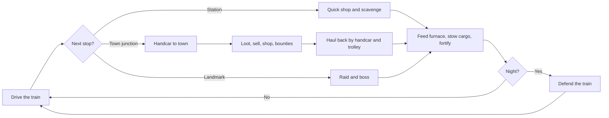
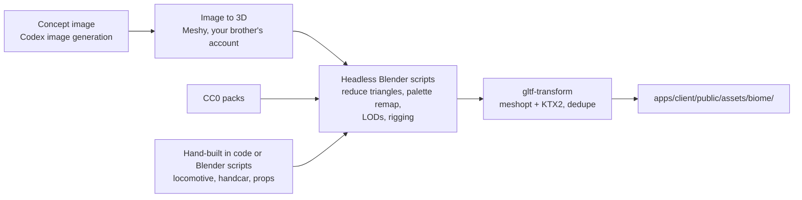
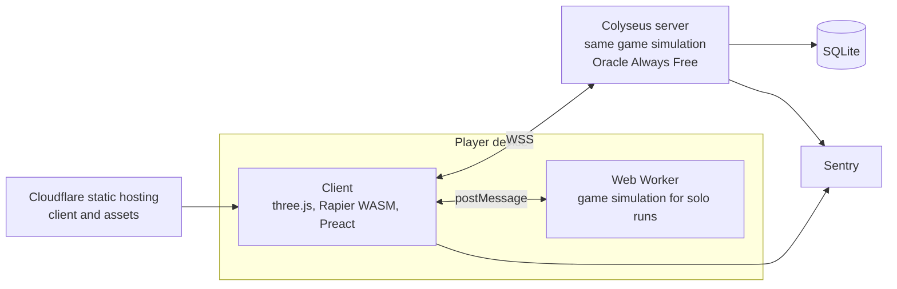

# Dead Tracks: Game Plan

> A polished, better version of Roblox's *Dead Rails*, playable in the browser on PC and phones. Up to 4 players ride a steam train 80 km across an undead frontier. Handcar detours to towns, cargo hauling and night defense decide whether the party makes it.

**Status:** Planning complete · **Last updated:** 2026-10-08 · **Name:** Dead Tracks

---

## Table of contents

1. [Vision](#1-vision)
2. [Decisions at a glance](#2-decisions-at-a-glance)
3. [Originality and legal](#3-originality-and-legal)
4. [Gameplay design](#4-gameplay-design)
5. [Art and audio](#5-art-and-audio)
6. [Technical architecture](#6-technical-architecture)
7. [Performance budgets and minimum devices](#7-performance-budgets-and-minimum-devices)
8. [Platforms and browser support](#8-platforms-and-browser-support)
9. [Hosting and deployment](#9-hosting-and-deployment)
10. [Telemetry and privacy](#10-telemetry-and-privacy)
11. [How we work and testing](#11-how-we-work-and-testing)
12. [Balancing](#12-balancing)
13. [Open source and funding](#13-open-source-and-funding)
14. [Roadmap](#14-roadmap)
15. [Risks and mitigations](#15-risks-and-mitigations)
16. [Open items](#16-open-items)
17. [Appendix: research notes](#17-appendix-research-notes)

---

## 1. Vision

### Pitch

The train is your base, your lifeline and your clock, and it can't follow you into town. Every detour on the handcar earns fuel, cash and guns, but the train sits alone while you're gone, and the sun keeps moving. When night falls, the dead come for the train.

### Goal

Keep everything that makes Dead Rails fun, and do each part better:

| Dead Rails | Dead Tracks |
|---|---|
| Items are dragged around with physics | Proper **pickup and carry**: a backpack for small items, two-handed carrying for bulky ones, snapping onto the train |
| Simple world interaction | **Rich interaction**: doors, drawers, breakable boards, ladders, searching bodies |
| Basic aiming | **Better gunplay**: hip fire, smooth first-person iron sights, recoil, bullet drop, clear hit feedback |
| Blocky Roblox characters | **Realistic proportions** in a clean low-poly style |
| Towns sit beside the track | **Towns off the main line, reached by handcar**, which forces a choice between guarding the train and looting |

### Design pillars

| Pillar | What it means in practice |
|---|---|
| **Keep the train moving** | Daylight, fuel and cargo are the constant trade-off |
| **Co-op first** | 1–4 players, classes give roles, reviving takes meds, the party splits for handcar trips |
| **Instant play** | Open a link and play. No install, no account needed |
| **Light on devices** | Hard budgets (§7). An iPhone 11 Pro must hold 30 fps |

### Non-goals for v1

- LAN play
- PvP
- Web game portals (CrazyGames, Poki)
- Native app-store builds
- Text or voice chat
- Mods and user-generated content
- An open world away from the track corridor

---

## 2. Decisions at a glance

Decided in the planning sessions on 2026-10-08.

| Area | Decision |
|---|---|
| Audience | Adults, 16+ age gate, English only |
| Platforms | Browser on Windows, Mac, iPhone and Android |
| Distribution | Own website on Cloudflare's free hosting (`dead-tracks.pages.dev`); no portals |
| Money | Free to play, funded by GitHub Sponsors |
| Code | Public GitHub repository, **AGPL-3.0** |
| Releases | A public pre-alpha playtest link early on; **v1.0 = the full 80 km run** |
| Party | **1–4 players**; solo runs entirely in the browser |
| Run | 80 km in 30–45 minutes, with 6-minute days and 4-minute nights |
| Biomes | Prairie → Badlands → Pine forest, with smooth blending between them |
| Towns | The train **never** enters towns. Towns are reached by **handcar** (which can tow a trolley) on spur lines |
| Camera | Third person, with hip fire; aiming switches to **first-person iron sights in 0.2 s**; no scopes |
| Carrying | Backpack for small items; two-handed carrying for bulky ones; snaps into train cargo slots or the furnace |
| Death | Downed for 30 s; reviving **needs meds**; otherwise respawn at the next station |
| Art | **Low-poly with realistic proportions**; only CC0 or CC-BY assets |
| Tech | TypeScript + three.js + **Rapier (WASM)**, with a Colyseus server; heavy code moves to Rust/WASM only if profiling shows a need |
| Hosting | Oracle Cloud Always Free in **Europe** for public play; your Mac plus Cloudflare Tunnel for development |
| Regions | One region (Europe) at $0; designed for more regions later (§9.2) |
| Budget | **$0** |

---

## 3. Originality and legal

We copy the **genre and mechanics**: a train journey, burning items for fuel, scavenging, a day/night cycle with undead enemies, selling loot, and a meta currency that unlocks classes. Mechanics generally can't be protected; creative expression can.

**Rules:**
- No Roblox or Dead Rails assets, models, sounds, music, UI art, logos or map layouts.
- **Original names** for places, classes, items, enemies, bosses and currencies. The names in this document are working names.
- Never use "Dead Rails" or "Roblox" in the game, store pages, ads or search keywords.
- Log every third-party asset and its license in `assets/LICENSES.md`, and credit CC-BY authors in-game.

**Content:** gore with dismemberment (with a toggle in settings) and a **16+ self-declared age gate** on the website.

This is not legal advice. If the game ever earns real money, get a short legal review.

---

## 4. Gameplay design

All numbers are **starting values** kept in data files and tuned with bots and playtests (§12).

### 4.1 Run structure

1. **Lobby:** create or join a party (1–4) with a room code or invite link, pick a class, and start. Solo play starts instantly.
2. **Departure:** km 0, at the starting station, with a little fuel, a starter weapon and one bandage each.
3. **The route:**
   - The HUD counts **km 0 to km 80**.
   - The world's actual length is a separate scale setting, starting at **1 HUD km = 250 m**, so the whole route is about 20 km of world space.
   - Spur lines and handcar distances are measured in real meters.
4. **Midpoint:** **Fort Ironwood** at km 40, on the main line. It's a safer stop with shops and a checkpoint defense event.
5. **Finale:** **Fort Haven** at km 80, on the main line. Hold out while the gate winches open, then roll through.
6. **Results:** bonds are awarded for distance, landmarks cleared, bounties and survival.

- **Target length:** 30–45 minutes, which is 3–4.5 day/night cycles.
- **Win:** at least one player is alive when the train rolls through Fort Haven's gate.
- **Loss:** every player is dead or downed at the same time.

### 4.2 Core loop



### 4.3 The train

**Cars:**

| Car | Purpose |
|---|---|
| Locomotive | Controls (throttle, brake, reverse lever, whistle), the furnace, and gauges for speed, fuel and pressure |
| Tender | Fuel storage |
| Flatcar | Cargo slots, fortification points, standing room |

**Fuel:**
- Every item has a `fuelValue`. Coal burns longest; wood and furniture are medium; paper and cloth are short.
- **Monster bodies burn** (or can be sold; see §4.10).
- Carry an item to the furnace and press E to throw it in.
- Fuel burns faster at higher speed. A **parked train still burns a little fuel**, about 10% of the cruising rate.
- With no fuel, the train coasts to a stop.

**Driving:**
- Top speed is about 20 m/s, with smooth acceleration and braking.
- **Reverse** is limited to about 5 m/s, for backing up after overshooting a junction or stop.

**The train is never destroyed.** The danger is to the players and the cargo.

**The parked train:**
- While everyone is away, enemies **climb aboard and wait**, so there's an ambush when you get back.
- They can **knock cargo off**. It lands beside the track and can be picked up again.
- The threat is lighter for solo and 2-player parties.

**Fortification:**
- Steel plates and barbed wire, bought at shops, snap onto fixed **fortification points**.
- They reduce how many enemies can board. Brutes can break them, and they can be repaired.

### 4.4 The route: stations, towns and handcars

**The main line** has these stops:

| Stop | Where | What's there |
|---|---|---|
| **Station** | On the main line, several per biome | Small general store (coal, bandages, basic ammo, plates); sells loot at **low prices**; a little loot; low danger |
| **Town** | About every 10 km (km 10, 20, 30, 50, 60, 70), **300–800 m off the main line** on a spur | Gunsmith, doctor (healing, tonics), general store, **trading post (best prices)**, sheriff (bounties); lots of loot in many buildings; high danger, especially at night |
| **Landmark** | One per biome, beside the main line | A raid with a boss and a simple puzzle (§4.6) |
| **Merchant wagon** | Random main-line stops | Random stock; buys loot at worse prices than towns |
| **Fort** | km 40 and km 80, on the main line | Safe-ish hub at km 40; the finale at km 80 |

**Junctions and spurs:**
- Each town has a junction on the main line, marked by a signpost and shown on the compass.
- **The train can't take the spur.** The track is too weak for the locomotive.
- A **handcar** waits at every junction.

**The handcar:**
- Seats up to 4. Players pump it, and its speed depends on how many are pumping: about **4 m/s with 1 player, up to 9 m/s with 4**. Pumping drains stamina.
- Carries **2 bulky items** plus backpacks.
- It can tow a **cargo trolley** (found or bought) for **2 more bulky items**.
- A round trip takes about 1–3 minutes plus time in town. Parties can only visit about **half the towns** per run, and that choice is the tension.

**Splitting the party:** some players take the handcar while others guard the train. A solo player has to leave the train alone; see "The parked train" in §4.3.

### 4.5 Biomes, day/night and weather

**Biomes (v1):**

| km | Biome | Character |
|---|---|---|
| 0–27 | **Prairie** | Open grassland, farms, windmills, long sight lines |
| 27–54 | **Badlands** | Red rock, mesas, canyons, bridges, mines |
| 54–80 | **Pine forest** | Dense, dark, foggy, short sight lines near the finale |

Biome borders **blend over about 500 m** of track: terrain colors, vegetation, sky, fog color and ambient sound.

**Day and night:**

| Phase | Length | Effect |
|---|---|---|
| Day | 6 min | Walkers and outlaws; scavenging time |
| Dusk | Inside the day | Warning: whistle, sky shift, spawns ramping up |
| Night | 4 min | Stronger and more numerous enemies, night-only types, low visibility |

The sun, sky, fog and lighting change gradually; nothing jumps.

**Night types** (one is rolled each night, with smooth transitions):

| Night | Effect |
|---|---|
| Clear | Baseline |
| **Full Moon** | Werewolves appear |
| **Blood Moon** | Vampires appear; red sky |
| Storm | Rain, lightning flashes, louder ambience covering footsteps |
| Fog | Very short view distance; enemies appear close |

**Daytime weather:** clear, rain, storm, fog, and dust storm (Badlands only). It changes **at most once per phase** and **blends over 30–60 s**: sky, fog, light, particles and sound. Weather mainly affects how far you can see and hear.

Rain and dust use cheap effects that phones can handle (§6.9).

### 4.6 Enemies, landmarks and bosses

**v1 enemies:**

| Enemy | When | Behavior |
|---|---|---|
| Walker | Always | Slow, in groups; the backbone of hordes |
| Runner | Always, more at night | Fast and fragile; sprints for the train |
| Brute | From night 2 | Tanky; breaks fortifications and knocks players down |
| Outlaw | Day | Human, ranged; guards camps; carries a **bounty** |
| Werewolf | Full Moon nights | Fast, leaps, hunts players who are alone |
| Vampire | Blood Moon nights | Agile, drains health, weak to holy water |

**Landmarks** (one per biome, working names):

| Biome | Landmark | Boss | Puzzle |
|---|---|---|---|
| Prairie | Grayson Ranch Manor | The Rancher (a giant undead) | Find the cellar key in the house |
| Badlands | Copperhead Mine and Lab | Dr. Voss (an electric scientist) | Restore power to open the vault |
| Pine forest | Blackpine Chateau | The Countess (a vampire) | Light the braziers to open the crypt |

**AI:**
- A state machine per enemy: `idle → wander → alerted → chase → attack`, plus `board-train` and `ambush-wait`.
- **Movement:** steering plus a navigation grid per chunk, generated from the world seed. Building interiors use recast-navigation (WASM) only if needed.

**Spawn director:**
- Works from a budget driven by distance along the route, time of day, night type, party size and **noise** (gunshots and the whistle attract enemies).
- **Hard cap:** 80 active enemies per room.

### 4.7 Combat and aiming

**Camera:**
- **Third person** by default, with **hip fire**: wider spread and a crosshair.
- **Aiming** (right mouse button, or the aim button on mobile) switches **smoothly in 0.2 s to first-person iron sights**, with slight zoom and slower walking.
- No scopes in v1.

**Hitting what you see:**
- Shots are calculated from the crosshair (a ray from the camera), then checked from the gun's muzzle.
- So you hit what you see, without bullets clipping on cover beside the character.

**Feel:**
- Recoil kicks the view; spread tightens while aiming.
- Hit markers, distinct hit and kill sounds, headshots ×2.

**v1 weapons:**

| Weapon | Type | Notes |
|---|---|---|
| Revolver | Pistol | Starter; 6 rounds, **reloaded one at a time** |
| Lever rifle | Rifle | Accurate; **slight bullet drop** at range |
| Coach gun | Double-barrel shotgun | Two shells; devastating up close; strong from the hip |
| Shovel | Melee | Doubles as a tool |
| Hatchet | Melee | Fast swings; breaks boards |
| Dynamite | Throwable | Area damage; clears barricades |
| Holy water | Throwable | Bonus damage against vampires and werewolves |

Ammo comes in separate types and is scarce.

**Gore:** blood decals, headshots that pop heads, limb loss on strong hits. A settings toggle turns it off.

### 4.8 Carrying, inventory and world interaction

**Backpack:**
- Holds small items: gold, valuables, ammo, bandages, tonics, keys, holy water.
- Limited slots, and slot count is the only limit. **Picking up is a single press.**

**Two-handed carrying:**
- Bulky items (coal sacks, furniture, bodies, crates, strongboxes) are carried in both hands, with proper animation.
- Carrying slows you down and drains stamina.
- **Snap placement:**
  - Facing the train, press E: the item snaps into the nearest free **cargo slot**.
  - At the furnace, press E: the item is burned.
  - Facing the handcar or trolley: the item is stowed there.
  - G drops the item; holding G throws it.

**Hotbar:** 6 slots for weapons, tools and consumables.

**World interactions:**
- Doors open and close.
- Drawers, cabinets and safes are searched by holding E.
- Boards and windows break with melee or dynamite.
- Ladders and train-car roofs can be climbed.
- Bodies can be searched.
- Levers: junction signals, the vault, the Fort Haven gate.

**Train cargo:**
- Objects stay physically on the train, tracked by the server.
- The cap is about **100 objects** per train, for performance.

### 4.9 Health, stamina, death and revive

**Health:**
- Regenerates slowly **up to 50%** after 10 s without damage.
- Above 50% needs bandages, tonics or the doctor.

**Stamina:** used by sprinting, melee, **pumping the handcar** and carrying heavy items. No hunger or thirst.

**Downed:**
- At 0 HP you're downed and bleed out over **30 s**.
- **Reviving requires meds.** A teammate holds E while holding meds:

| Med | Revives to |
|---|---|
| Bandage | 25% health |
| Tonic | 75% health |

- No meds means no revive.

**Death:** a player who bleeds out spectates and **respawns on the train when it passes the next station**.

**Solo:**
- Every solo run starts with **1 tonic**, and more can be bought.
- When downed, you can **use a tonic on yourself**. Without one, the run ends.

### 4.10 Economy

| Currency | Scope | Earned by | Spent on |
|---|---|---|---|
| **Cash ($)** | One run, per player | Selling valuables and **monster bodies**, outlaw **bounties** at the sheriff | Ammo, guns, meds, fuel, plates, holy water, trolley |
| **Bonds** | Permanent | Distance milestones, landmarks cleared, finishing, rare bond items | Classes; cosmetics later |

**Where to sell:**
- Town **trading posts** pay the best prices.
- **Station** stores and the **merchant wagon** pay less.

**Sharing:** wallets belong to each player, and players can drop cash to share it.

### 4.11 Classes

| Class | Unlock | Perks | Starting kit |
|---|---|---|---|
| **Drifter** | Free | Balanced | Revolver, shovel |
| **Medic** | Bonds | Revives 50% faster; meds heal more | Revolver, 2 bandages |
| **Engineer** | Bonds | Furnace burns fuel 20% slower; fortifies and repairs fast; pumps the handcar faster | Coach gun, hatchet |
| **Gunslinger** | Bonds | Reloads 30% faster; better hip-fire accuracy; +25% headshot damage | Revolver ×2 |
| **Prospector** | Bonds | Spots valuables nearby; sells loot for +15%; moves faster while carrying | Shovel, lantern |
| **Preacher** | Bonds | +50% damage against werewolves and vampires | Revolver, 2 holy water |

### 4.12 Progression and accounts

- **Saved on the server:** bonds, unlocked classes, lifetime stats. Runs in progress are **not** saved.
- **Guest first:**
  - No sign-up. The game creates a guest identity on the server, with a token kept in the browser.
  - Optional **sign-in with Discord, Google or GitHub** keeps progress safe and works across devices.
  - Guest progress transfers to the account on first sign-in.
- **Usernames** are generated automatically and can be changed, with a profanity filter.

### 4.13 Controls

| Action | PC | Mobile |
|---|---|---|
| Move | WASD | Left virtual stick |
| Look | Mouse (Pointer Lock) | Drag on the right half of the screen |
| Fire | Left mouse button | Fire button |
| Aim (iron sights) | Right mouse button | Aim button |
| Reload | R | Button |
| Interact / pick up / snap | E (hold to search or revive) | Context button |
| Drop / throw | G (hold to throw) | Button while carrying |
| Jump / sprint | Space / Shift | Buttons |
| Hotbar | 1–6, scroll wheel | Tap a slot |
| Ping wheel | Middle mouse / Z | Ping button |
| Pump handcar | Hold Space, or alternate W/S | Pump button |

Gamepad support comes later.

### 4.14 Communication and social

- **Party join:** room codes and invite links (`/join/ABCD`).
- **Ping wheel:** "Fuel here!", "Help!", "Stop the train!", "Go!", "Enemy!", "Need meds!". You can also **point at a spot** to mark it in the world and on teammates' compasses.
- Text chat comes later, with a filter, mute and report. No voice chat.

### 4.15 HUD and settings

**Minimal HUD:**
- Small health and stamina bars.
- Ammo next to the crosshair; the hotbar.
- A **compass strip** with markers for the train, stations, junctions, landmarks and pings.
- A time-of-day icon.

**Train readouts:**
- Fuel, speed and pressure are read on the **locomotive's gauges**.
- When you're away from the train, a small **train-status widget** (fuel and distance to the train) appears so you know when to head back.

**Settings:**
- Graphics quality (auto-detected, can be overridden), field of view, sensitivity, invert Y.
- Gore toggle, volume sliders (master, music, effects).
- Key rebinding, colorblind-safe markers, camera-shake toggle.
- Subtitles for important sound cues, a 30/60 fps cap.

### 4.16 After v1

These are planned for later, in rough priority order:
1. Horses
2. Train unlocks bought with bonds
3. Modes (Short 40 km, Nightmare, Endless)
4. Text chat
5. Mounted guns on the train
6. Armor
7. Robbable banks
8. Scoped rifles
9. More classes and mastery trees
10. More biomes
11. Live events and a challenge board
12. Gamepad support
13. Cosmetics

---

## 5. Art and audio

### 5.1 Style

**Low-poly with realistic human proportions.** Clean shapes, flat or palette-based colors, no cartoon heads.

- **Consistency:** one shared **palette texture** and one shared stylized shader across all assets, so packs from different authors look like one game.
- **Mood:** comes from **lighting, fog, weather and the night sky**.

**Extra detail:**
- **Up close:** first-person guns and arms (seen in iron sights) and the locomotive get more geometry, in the same style.

**Polygon budgets:**

| Asset | Triangles |
|---|---|
| Player character | 3–5k |
| Zombie | 2–3k |
| Building | 2–6k |
| Small prop | under 500 |
| Locomotive | 8–12k |
| First-person gun and arms | 3–5k |

All humanoids share **one skeleton**, so players, zombies, outlaws, bosses and townsfolk use the same animations.

### 5.2 License rules

The repository is public, so assets are part of what we publish.

| Allowed in the repo | Not allowed |
|---|---|
| CC0, CC-BY (credited), our own work, Meshy free-tier output (CC BY; credit Meshy) | Mixamo (no redistribution of raw files), Fab/Unity Store/Synty (unclear for web and public repos), Sonniss GDC bundles, anything with "NC", "ND" or no license |

Every asset gets a line in `assets/LICENSES.md`: name, author, source URL, license, and what we changed.

### 5.3 Candidate free sources

Verify each pack's license when it's imported.

| Need | Source | License |
|---|---|---|
| Western buildings and modular town pieces | Ankers "Low Poly Wild West" (150+ modular pieces) | CC0 |
| Western props | OpenGameArt "Low Poly CC0 Western Objects" | CC0 |
| Graveyard props | Kenney Graveyard Kit | CC0 |
| Nature (trees, rocks, plants) | Quaternius Ultimate Nature | CC0 |
| Ground and wood textures (sampled into the palette) | ambientCG | CC0 |
| Guns | CC0 revolver and rifle models on OpenGameArt (lever rifle and double-barrel to be made) | CC0 |
| Human bodies | Quaternius Universal Base Characters, MakeHuman/MPFB core assets | CC0 |
| Animations | Quaternius Universal Animation Library 1 and 2, free tier (45 + 42 clips, including zombie movement) | CC0 |

### 5.4 Asset pipeline



**Concept images:**
- Made with **Codex CLI** (`codex exec`, image generation; installed, v0.161).
- Clean front and side views on a plain background, with T-poses for characters.

**Meshy:**
- About **10 models a month** on the free tier, uploaded and downloaded by your brother under his own account.
- Free-tier output is CC BY, so we credit Meshy.
- I prepare each batch as a folder of images, settings and a priority list.

**Meshy priority** (the hardest-to-make assets first):
1. The three bosses
2. Werewolf and vampire
3. Clothing for outlaws and the sheriff
4. Distinctive town props: furnace, merchant wagon, saloon pieces
5. Townsfolk variants

**Built by me** in code or headless Blender scripts:
- The **locomotive** (an American 4-4-0 type from public-domain drawings, with moving wheels and rods)
- The **handcar** and trolley
- Track pieces, crates, fences, signposts, fortification plates

**Blender:** always runs headless (`blender -b -P script.py`). Nothing opens on screen.

**Assets ship per biome**, so each biome downloads as the train approaches.

### 5.5 Characters and animation

**Characters:**
- CC0 base bodies plus simple clothing pieces: hats, dusters, vests, bandanas, boots.
- **Zombies reuse the same bodies** with rotting textures and torn clothes.

**Animation sources:**
- **Base movement:** walk, run, idle, zombie walks and attacks from the **free Quaternius clips**.
- **Code-driven animation in the game:** hands on carried items (IK), aiming and recoil, handcar pumping, ladder climbing, head-look, hit reactions.
- **Scripted keyframes:** missing clips such as revolver reload, shell loading, furnace loading, lever pulls and revive. Written with Blender Python scripts.
- **First purchase** when Sponsor money arrives: the full Quaternius animation library ($9.99, 120+ clips).

### 5.6 Audio

- **Sources:** only CC0 or CC-BY (credited) sound effects and music, for example Freesound filtered to CC0/CC-BY, and OpenGameArt.
- **3D sound:** positional audio through the Web Audio API.
- **Format:** compressed MP3/AAC, which works in every browser.
- **Layers:**
  - Ambient loops for each biome and each weather type, crossfaded during transitions.
  - Night drone layers, a different layer for each night type.
  - Locomotive sounds tied to speed: chuff, whistle, brakes.

---

## 6. Technical architecture

### 6.1 Stack

| Layer | Choice | Why |
|---|---|---|
| Language | **TypeScript** (strict) | The same code runs in the browser, in the solo worker and on the server |
| Package manager | **pnpm** workspaces | Monorepo support; the shared package store saves disk space |
| Build | **Vite** | Instant reload; the dev server can be opened on a phone over Wi-Fi |
| Rendering | **three.js** `WebGPURenderer` | Uses WebGPU when available, WebGL2 otherwise |
| Physics | **Rapier** (`@dimforge/rapier3d-compat`, **WASM**) | Fast, small, built-in character controller; client and server |
| Asset decoding | meshopt + Basis/KTX2 transcoders (**WASM**) | Small downloads that decode fast |
| UI | HTML/CSS overlay + **Preact** | About 3 KB; keeps the HUD and menus out of the 3D canvas |
| Multiplayer | **Colyseus** on **Node.js 24 LTS** | Rooms, matchmaking, delta state sync, per-client views, reconnection |
| Database | **SQLite** with Drizzle ORM | No setup on a single server; Postgres later if needed |
| Auth | Guest tokens + OAuth (Discord, Google, GitHub) | Free providers, no passwords to store |
| Tests | **Vitest**, **Playwright** (headless), bot clients | Unit tests, browser smoke tests, load and balance testing |
| Errors | **Sentry** free tier | Crash reports from real devices |
| CI | **GitHub Actions** | Lint, typecheck, test and build on every push |

### 6.2 WebAssembly strategy

The game is **TypeScript plus WASM where it pays off**:

| Part | Runs as |
|---|---|
| Physics (Rapier) | WASM (Rust) |
| Texture and mesh decompression | WASM |
| Building navigation meshes, if needed | WASM (recast-navigation) |
| Game logic, UI, networking | TypeScript |
| Graphics | WebGPU / WebGL2 |

**Rust escape hatch:** if profiling on the **iPhone 11 Pro** shows the 80-enemy nights are limited by CPU, the **horde simulation** (steering, AI ticks) moves into a Rust module compiled to WASM behind the same interface. Nothing else gets rewritten.

WASM doesn't speed up drawing: graphics calls go through the same browser API either way. So rendering performance comes from batching, instancing and LODs (§6.9).

### 6.3 System overview



### 6.4 Repository layout

```
dead-tracks/
├─ apps/
│  ├─ client/                 # Vite + three.js game client
│  │  ├─ src/
│  │  │  ├─ core/             # game loop, clock, input, settings, quality tiers
│  │  │  ├─ render/           # renderer, palette shader, sky/fog/weather, LOD, instancing
│  │  │  ├─ world/            # chunk streaming, terrain, spur lines, prop meshes
│  │  │  ├─ net/              # Colyseus adapter + local worker adapter (same interface)
│  │  │  ├─ gameplay/         # player, aiming/viewmodel, carrying, train and handcar views
│  │  │  ├─ ui/               # HUD, compass, ping wheel, menus, touch controls (Preact)
│  │  │  ├─ audio/
│  │  │  └─ worker/           # runs packages/sim for solo play
│  │  └─ public/assets/
│  └─ server/                 # Colyseus server: rooms, matchmaking, accounts
│     └─ src/
│        ├─ rooms/            # LobbyRoom, RunRoom (thin adapters over packages/sim)
│        ├─ schema/           # Colyseus state schemas
│        ├─ auth/             # guest tokens, OAuth
│        ├─ central/          # accounts/progress API that regional room servers report to
│        └─ persistence/      # SQLite: players, bonds, unlocks, stats
├─ packages/
│  ├─ sim/                    # authoritative game simulation (NO Colyseus import)
│  │  ├─ train/  handcar/  ai/  director/  combat/  carry/  economy/  weather/
│  └─ shared/                 # used everywhere
│     ├─ worldgen/            # seeded route, spurs, towns, chunks (deterministic)
│     ├─ movement/            # player movement (prediction + simulation)
│     ├─ data/                # weapons, items, enemies, classes, prices (tuning tables)
│     └─ protocol/            # messages, quantization
├─ tools/
│  ├─ assets/                 # headless Blender scripts, gltf-transform, Meshy batch prep
│  ├─ bots/                   # bot players for load and balance tests
│  └─ concepts/               # Codex prompt files for concept images
├─ assets-src/                # source .blend files, concept images (Git LFS)
├─ assets/LICENSES.md
└─ docs/
```

### 6.5 Simulation core and solo play

- `packages/sim` holds the **entire authoritative game**: train, handcar, AI, spawn director, combat, carrying, economy, weather and day/night.
  - It's plain TypeScript with no networking code.
  - It exposes `step(dt, inputs) → stateChanges`.
- **Multiplayer:** `apps/server` wraps the simulation in a Colyseus `RunRoom` that turns inputs and outputs into messages and synced state.
- **Solo:** the client runs the same simulation in a **Web Worker**, connected through an adapter with the same interface as the network one.
  - Solo needs **no server**. It works offline once the game files are cached, and it gives instant test runs.
  - Bonds earned offline sync when you're back online.
  - Solo runs happen on the player's own device, so solo bonds could be cheated. That's accepted, because bonds only unlock classes and cosmetics and there are no leaderboards.

### 6.6 Deterministic world generation

- **Pure function:** `generateChunk(seed, chunkIndex)` lives in `packages/shared` and gives identical output on Node and in every browser. Seeds come from a seeded random generator (`sfc32`); `Math.random()` is never used in world generation.
- **Integer hashing for decisions:** results from `Math.sin`, `Math.cos` and `Math.pow` can differ slightly between JS engines. They're used only for visual placement, never for decisions like "place a building here?".
- **The generator lays out:**
  - The main line
  - Junctions and **spur lines** to towns (300–800 m)
  - Station and landmark placement
  - Town layouts built from **modular kit pieces**
  - Biome blend zones
- **Clients** generate the static geometry. **The server** owns dynamic state: loot, enemies, doors, cargo, handcar positions.
- **CI check:** chunk hashes for a fixed seed must match on Node, Chromium and WebKit.

### 6.7 Coordinates and the large world

**Track space:**
- Gameplay positions are stored as `(track, s, lateral, height)`, where `track` is the main line or a spur ID and `s` is the distance along it.
- The whole position of the train or handcar is just `(track, s)`.

**Precision:**
- JS numbers are 64-bit, so the simulation has no precision problems over the route.
- The GPU and Rapier use 32-bit floats, so they do.

**Floating origin:** every 1 km, the render scene and the physics world are shifted so the camera stays near (0,0,0). On the server, each room keeps its physics origin near the action.

### 6.8 Networking

**Regions:** at launch there is one game server, in Europe. The client is still built to pick a region by ping, and party codes include the region, so more regions can be added later as configuration (§9.2).

**Rooms:**
- `LobbyRoom`: party formation, class selection.
- `RunRoom`: one per party (1–4 players).

**Rates:**
- The simulation runs at **30 Hz**.
- State patches go out at **20 Hz**.
- Clients send inputs at 30 Hz: sequence number, movement, yaw/pitch, buttons.

**Local player:**
- **Client-side prediction:** the client runs the shared movement code immediately.
- **Reconciliation:** when server state arrives, the client corrects itself and replays inputs the server hasn't processed yet.

**Others:** remote players and enemies use snapshot interpolation with a ~100 ms buffer.

**Vehicles:**
- The train and handcars are sent as `(track, s, speed)`. Clients extrapolate and smooth, so there's no jitter.
- Players riding them sync in **vehicle-local coordinates**, which prevents rubber-banding on moving platforms. Getting on or off converts between vehicle and world space.

**Interest management:**
- Each client has a Colyseus `StateView` covering entities within ~150 m.
- Enemies and props use streamed collections ordered nearest first, with a per-tick limit.
- Handcar trips and train guards can be far apart, so each sees only what's nearby.

**Quantization:** positions are sent as int16 centimetres relative to the chunk or vehicle; angles as uint16.

**Hits:** the client reports hits; the server checks them (fire rate, ammo, range, line of sight, a latency window). Responsive and cheap, and fine for co-op PvE.

**Server-authoritative only:** inventory, cash, bonds, loot rolls, enemy health, fuel, cargo.

**Transport:** WebSocket over TLS (`wss://`).

**Reconnection:** mobile browsers suspend background tabs, so a dropped player's slot is held for 60 s. Their character goes idle and is protected while they're gone.

### 6.9 Client rendering and performance

**Quality tiers (Low / Medium / High):**
- Picked automatically by a 2-second benchmark at startup plus device hints.
- The player can override the choice.

**Batching:** one palette texture and shared materials, so nearly everything batches. Foliage, props, fences and rails use `InstancedMesh` and `BatchedMesh`.

**Hordes:**
- The nearest 8–10 enemies are full skinned meshes.
- The rest use **vertex animation textures** (animation baked into a texture and played on the GPU), so the whole horde costs a few draw calls.

**Level of detail:**
- 3 detail levels per model, plus flat billboards for distant trees and buildings.
- The far clipping distance sits inside the fog.

**Lighting:**
- One sun or moon light, plus at most 4 dynamic lights on Low and 8 on High.
- Extra lanterns fake their glow with emissive sprites.

**Shadows:**

| Tier | Shadows |
|---|---|
| Low | Blob shadows |
| Medium | One shadow map around the player |
| High | Cascaded shadows |

**Weather effects:**
- Rain and dust are GPU particles in a box around the camera.
- Lightning is a light flash plus a sky flash.
- Weather changes blend through shared uniforms: fog density and color, sky gradient, wetness tint.

**First-person view:** the arms-and-gun model is drawn in a separate pass with its own camera field of view, so it never clips into walls.

**Frame rate:**
- Dynamic resolution holds the frame target.
- A 30 or 60 fps cap; mobile defaults to 30.
- Rendering pauses when the tab is hidden.

**Memory:**
- Chunk geometry and textures are freed when a chunk unloads.
- Enemies, projectiles and effects are pooled.
- No per-frame allocations in hot code, to avoid garbage-collection stutters.

### 6.10 Server simulation

**Tick order:**
1. Inputs
2. Players
3. Vehicles (train, handcars)
4. Spawn director
5. AI
6. Combat
7. Carrying and cargo
8. Economy
9. Weather and time of day
10. Cleanup
11. State write

**AI levels of detail:**

| Enemy distance from the nearest player | Update rate |
|---|---|
| Under 80 m | Every tick |
| 80–150 m | 5 Hz |
| Over 150 m | Asleep, or recycled if behind the train |

**Physics:** Rapier colliders exist only for chunks near players. Town chunks load only while someone is in that town.

**One Node process** hosts many rooms. Oracle's 2 cores and 12 GB comfortably fit early player counts.

### 6.11 Security

- The server is authoritative for everything that matters.
- **Input checks:** movement speed limits, teleport detection, per-client message rate limits.
- **Sessions:** signed tokens (JWT). OAuth secrets live only on the server; nothing secret is in the client.
- HTTPS and WSS only.
- **Public code:** cheat-makers can read it. That's acceptable for co-op PvE, because the server decides outcomes.

---

## 7. Performance budgets and minimum devices

These are **targets checked at each milestone**. A milestone isn't done if it breaks a budget.

| Metric | Mobile (Low tier) | Desktop (High tier) |
|---|---|---|
| Frame rate | Stable 30 (60 optional) | 60+ |
| Draw calls per frame | ≤ 150 | ≤ 500 |
| Visible triangles | ≤ 250k | ≤ 1.5M |
| GPU texture memory | ≤ 128 MB | ≤ 512 MB |
| JS heap | ≤ 200 MB | ≤ 400 MB |
| Download before play | **≤ 25 MB** | **≤ 25 MB** |
| Whole game, streamed per biome | **≤ 80 MB** | **≤ 80 MB** |
| Time to playable (4G / broadband) | ≤ 20 s | ≤ 10 s |
| Network down / up per client | ≤ 15 / 4 KB/s | ≤ 15 / 4 KB/s |
| Active enemies per room | ≤ 80 | ≤ 80 |
| Server tick time (p95) | ≤ 10 ms per room with 4 players and 80 enemies | same |

**Minimum and test devices:**

| Role | Device |
|---|---|
| **Minimum iPhone, and a test device** | **iPhone 11 Pro** (30 fps on Low) |
| High-end Android test device | Galaxy S23 (60 fps) |
| Development and high-end desktop | MacBook Pro with M1 Pro, 32 GB |
| Minimum Android | About 2020 mid-range with 4 GB RAM. **No physical test device**, so it's simulated with browser CPU throttling |
| Minimum PC | Integrated graphics from about 2018 |

A development-only **performance HUD** shows fps, frame time, draw calls, triangles, memory, ping and KB/s.

---

## 8. Platforms and browser support

**Required:** WebGL2. WebGPU is used automatically when available. Devices without WebGL2 get a friendly "unsupported device" page.

| Platform | Browsers | Notes |
|---|---|---|
| Windows | Chrome, Edge, Brave (primary); Firefox | Pointer Lock |
| macOS | Chrome (primary), Safari, Firefox | Safari is tested every milestone |
| Android | Chrome (primary), Samsung Internet | Fullscreen + landscape lock |
| iPhone / iPad | Safari and every other iOS browser (all use WebKit) | See the iOS notes below |

**iOS notes:**
- iPhone Safari can't make a game fullscreen. The game prompts **"Add to Home Screen"**, which runs it as a standalone, landscape web app (PWA). This works because the game is on our own site, not inside a portal.
- Audio starts on the first tap ("Tap to start").
- Safari kills tabs that use too much memory, so the §7 budgets are firm limits.

**All mobile:** the **Screen Wake Lock** keeps the screen on during runs; haptics work on Android only (Vibration API).

**Offline:** a service worker caches the game files, so solo play works offline after the first visit.

---

## 9. Hosting and deployment

| Piece | Choice | Cost |
|---|---|---|
| Website and assets | **Cloudflare** free static hosting, `dead-tracks.pages.dev` | $0 |
| Game server (public) | **Oracle Cloud Always Free** Arm VM in **Europe**: 2 cores, 12 GB RAM, 10 TB/month outbound (as of Oct 2026) | $0 |
| Development server | Your Mac + **Cloudflare Tunnel** (free) | $0 |
| TLS / reverse proxy | Caddy on the Oracle VM (automatic certificates for `wss://`) | $0 |
| Database | SQLite file on the VM, backed up nightly | $0 |
| Error tracking | Sentry free tier | $0 |
| Domain | Free subdomain; buy a real domain later with Sponsor money | $0 |

**Oracle notes:**
- **Signing up** needs a real credit or debit card for verification (prepaid and virtual cards are refused).
- **One free account per person.** Creating more is prohibited, so at $0 there is exactly **one region**.
- **The home region is chosen once** at signup and can't be changed. **Decision: a European region.** First choice Frankfurt or London; if free servers there are "out of capacity", choose a less busy EU region (Amsterdam, Paris, Stockholm and others), which gives similar ping.
- New servers sometimes fail with **"out of capacity"**. Retrying in another availability domain usually works.
- Oracle may **reclaim idle free servers**. Upgrading the account to pay-as-you-go avoids that and still costs $0 within the free limits. Set a **$0 budget alert**.

### 9.1 Regions and ping

Europe sits between the likely player bases, so nobody is far from the server. Typical round-trip times from a European server (approximate):

| Players in | Ping to Europe |
|---|---|
| Europe | 10–40 ms |
| US East | 80–100 ms |
| India | 110–150 ms |
| US West | 140–170 ms |

**How ping feels in this game:**
- **Your own movement and aiming are instant at any ping**, because of client prediction.
- **Hits are reported by the client**, so if you hit a zombie on screen, it counts.
- **Pickups, doors and other server-confirmed actions** start their animations on the client right away, so the wait isn't visible.
- **Solo runs** run in the browser, so they have no ping at all.
- Up to ~170 ms is comfortable for co-op PvE.

### 9.2 Multi-region design (built from day one, used later)

Adding regions later should be configuration only, with no code changes:

- **One central service** for accounts, progress and bonds, on the Oracle server in Europe.
- **Game rooms run on any number of regional servers.** Each one runs only the Colyseus `RunRoom`s and reports results back to the central service through an authenticated API.
- **Region choice:**
  - The client measures its ping to each available region and picks the best.
  - A party plays in its **creator's region**.
  - Party codes include the region, so friends always join the right server.
- **Region list** comes from a small config file served with the website.
- **Adding a region** once Sponsor money arrives:
  - A small paid server (a few dollars a month) in the **US**, and later **Asia**.
  - Deploying it is the same Docker image with a different config.
- **Optional free fallback (later):** the game logic already runs in the browser for solo play, so a friend group far from every server could host on one player's browser through a peer-to-peer (WebRTC) connection.

**Deploys:**
- `git push` to `main` → GitHub Actions → client to Cloudflare, server as a Docker image to the VM.
- Graceful restarts: new rooms go to the new version, and old rooms finish first.

**Versions:**
- Client and server share a **protocol version**. An outdated cached client (from the PWA) is told to reload before joining.
- The service worker checks for updates on each launch.

**Monitoring:** Sentry, a free uptime check, and server metrics in the logs (concurrent players, rooms, tick time p95, bandwidth).

---

## 10. Telemetry and privacy

- **Crash and error reports:** Sentry free tier, from client and server.
- **Anonymous gameplay stats** stored in our own database:
  - Runs started and finished, and where they end.
  - Where players die and what killed them.
  - Towns visited, fuel and cash curves.
  - fps and quality tier per device class.
- **Not collected:** ad trackers or third-party analytics. Guests get a random ID with no personal data. Signed-in accounts store only the OAuth provider ID and a display name.
- A short **privacy notice** on the website explains all of this. Text chat (later) will need moderation, which is one reason it's deferred.

---

## 11. How we work and testing

**Roles:**
- **I** write the code, build the assets and do almost all of the testing.
- **You** do short "how does it feel" checks on the **iPhone 11 Pro**, **Galaxy S23** and the Mac, when you have time (often weekends).
- **Your brother** does Meshy batches.

**No pop-ups:** everything runs **headless**, so nothing opens on your screen while I work:
- Blender in background mode
- Playwright headless browsers
- `codex exec` for concept images

**Testing layers:**

| Layer | Tooling | What it covers |
|---|---|---|
| Unit | Vitest | `packages/sim` and `packages/shared`: world generation, movement, combat math, economy, carrying |
| Determinism | CI job | World-gen hashes match on Node, Chromium and WebKit |
| Room integration | `@colyseus/testing` | Join/leave, reconnection, authoritative rules |
| Browser smoke | Playwright, headless Chromium **and** WebKit | Loads, joins, renders, no console errors; screenshots stored for review |
| Netcode | Developer menu toggles | Simulated latency (0–300 ms), jitter and packet loss |
| Bots | Headless bot players running the real sim | Full-run soak tests, load tests (e.g. 30 rooms × 4 bots), balance simulations |
| Performance | Playwright with CPU throttling, plus device checks | §7 budgets, especially the low-end Android simulation |

---

## 12. Balancing

- **Data files:** every tunable number lives in `packages/shared/data`: prices, fuel values, enemy stats, spawn budgets, rewards, handcar speeds, day/night lengths.
- **Bot simulations:** full runs to check the economy, for example "can a 2-player party afford enough fuel while visiting 3 towns?" and "how often does a solo run die at night 2?".
- **Developer tuning panel:** a hidden in-game panel to change numbers live, save presets and skip time and distance, so nobody has to play 40 minutes to test the finale.
- **Feedback:** your "too hard / too easy" notes plus the anonymous stats (§10) drive changes.

---

## 13. Open source and funding

- **Code:** a public GitHub repository under **AGPL-3.0**. Anyone can read it and contribute. Anyone running a modified copy online must publish their changes.
- **Assets:** each asset keeps its own license (CC0 or CC-BY), listed in `assets/LICENSES.md`.
- **Name and logo:** the "Dead Tracks" name and logo are **not** open-licensed.
- **Funding:**
  - **GitHub Sponsors**, linked from the game's main menu and the README.
  - Development happens in the open, with a public pre-alpha link and milestone updates, to earn stars and sponsors.
- **First spending** when money arrives:
  1. The full Quaternius animation library ($9.99)
  2. A domain
  3. Meshy credits

---

## 14. Roadmap

v1.0 is the **full 80 km game**, built in playable steps. Every milestone has a "done when" test.

Art production runs **alongside** the code from M1: one Meshy batch a month, plus hand-built assets. Placeholders are used until each asset lands.

### M0: Foundations
- pnpm monorepo, strict TypeScript, ESLint/Prettier, Vitest, GitHub Actions, AGPL license file.
- `packages/sim` and `packages/shared` scaffolding.
- Vite client, plus the solo worker adapter.
- Colyseus server, plus the network adapter.
- Performance HUD.

**Done when:** `pnpm dev` runs a solo session in a worker *and* a 2-client session through the local server, both showing the same synced test object.

### M1: The train runs (solo)
- Seeded main line and chunk streaming, the Prairie biome, sky, fog, day/night.
- Train controls: throttle, brake, reverse, furnace, fuel, gauges.
- Walking and jumping on the moving train.
- Floating origin, quality tiers, touch controls.
- The palette shader. The hand-built locomotive (first version).

**Done when:** driving 20 km on the **iPhone 11 Pro** holds 30 fps, with no jitter while walking on the moving train.

### M2: Multiplayer core
- `RunRoom`, joining by party code or link.
- Prediction, reconciliation, interpolation.
- Vehicle-local sync, reconnection, latency simulation, bot clients.

**Done when:** 4 players (mixed phones and PC) at 150 ms simulated latency move around the moving train with no visible rubber-banding.

➡️ **Public pre-alpha #1.** Needs the Oracle sign-up (European region) and the Cloudflare sign-up (§16).

### M3: Combat and enemies
- Revolver, lever rifle, coach gun, melee, dynamite.
- Hip fire, the 0.2 s iron-sight transition, recoil, hit feedback.
- Walkers, runners, brutes; the spawn director with noise.
- Downed state and revive with meds; respawn at stations; solo tonic.
- Gore with its toggle; vertex-animated hordes; interest management.

**Done when:** 4 players against 80 night enemies stay within every §7 budget on the iPhone 11 Pro and on the server.

### M4: Carrying, interaction and economy
- Backpack, two-handed carrying, snap slots, the furnace.
- Bodies as fuel and loot.
- Doors, drawers, breakables, ladders.
- Station shops, the merchant wagon, cash.
- Fortification points.

**Done when:** a full loop works end to end: stop, loot, carry, burn, stow, sell, buy, fortify, depart.

### M5: Junctions, handcars and towns
- Spur generation; handcar pumping, seats and stamina; the trolley.
- Modular towns with gunsmith, doctor, general store, trading post and sheriff (bounties); outlaws.
- The parked-train threat and the small fuel burn while parked.

**Done when:** a 2-player run can split up, one taking the handcar to a town and one guarding, and both halves feel tense and fair.

➡️ **Public pre-alpha #2.**

### M6: The full route
- Badlands and Pine forest, with **biome blending**.
- The **weather system** and **night types** with smooth transitions.
- Werewolves, vampires, holy water.
- The 3 **landmark raids** with bosses and puzzles.
- Fort Ironwood and the **Fort Haven finale**.

**Done when:** bots and a playtest complete km 0 to 80 in 30–45 minutes, with every transition smooth.

### M7: Meta, accounts and interface
- Bonds, the 6 classes, the lobby and party codes.
- Guest accounts plus Discord, Google and GitHub sign-in, with progress transfer.
- Usernames, the ping wheel and world markers.
- The final HUD, compass and train widget; every setting; the 16+ gate.

**Done when:** bonds and unlocks survive a reload and a device switch after sign-in.

### M8: Polish and v1.0
- Mobile UX, the PWA install prompt, offline solo.
- A performance pass on the device list in §7.
- A balancing pass with bots.
- The art pass: replace remaining placeholders; credits screen.
- Sentry plus anonymous stats, the privacy notice.

**Done when:** every §7 budget is met, there are no blocking bugs, and ≥ 99% of sessions are crash-free in a 1-week open playtest.

➡️ **v1.0 release.**

**After v1:** the list in §4.16. The **Rust/WASM horde module** (§6.2) is pulled in whenever profiling calls for it, at any milestone.

---

## 15. Risks and mitigations

| Risk | Impact | Mitigation |
|---|---|---|
| Very little testing time, with a full 80 km scope | Slow feedback, bugs found late | Automated bots, headless browser tests and screenshots; a developer panel to skip ahead; your checks kept short |
| Meshy limited to about 10 models a month | Art bottleneck | Hardest assets first; everything simple is built in code or Blender scripts; placeholders until assets land |
| AI-generated models are inconsistent or messy | Clashing look | Palette remap plus a shared shader; triangle reduction and cleanup scripts; strict concept prompts with one style guide |
| Animations made by code and scripts look stiff | Weaker feel | Free clips for movement; code-driven IK hides seams; buy the full animation set first |
| Oracle capacity, reclamation or signup problems | No public server | Retry other availability domains; pay-as-you-go with a $0 budget alert; fallback to your Mac + Tunnel for playtests |
| iOS Safari memory crashes | Crashes on iPhones | Strict budgets, KTX2 textures, per-biome loading, testing on the iPhone 11 Pro every milestone |
| Jitter on the moving train or handcar | Core feel broken | Vehicle-local sync from M2; latency simulation in every netcode test |
| Mobile background tabs drop connections | Lost players | 60 s reconnection window with idle protection |
| No low-end Android device | Performance surprises | CPU-throttled browser runs; anonymous fps stats from real players; a conservative Low tier |
| License contamination in the public repo | Takedown | CC0/CC-BY only; the license log is reviewed when assets are added; no Mixamo, Fab or Sonniss |
| Meshy account rules | Lost access or unclear asset rights | Your brother uploads under his own account (no shared login); free output is CC BY and credited |
| Players cheat in solo | Unearned bonds | Accepted: bonds only unlock classes and cosmetics, and there are no leaderboards |
| IP claims as a Dead Rails clone | Takedown | Original assets and names (§3); no Dead Rails or Roblox branding |

---

## 16. Open items

| Item | Who | Needed by |
|---|---|---|
| Oracle Cloud signup (your credit card), with a **European home region** (§9) | You | Before public pre-alpha #1 (end of M2) |
| Cloudflare account for hosting | You | Before public pre-alpha #1 |
| GitHub Sponsors profile | You | Before public pre-alpha #1 |
| Meshy batches | Your brother | Monthly, from M1 |
| Final names for landmarks, bosses and forts | You and me | M6 |

---

## 17. Appendix: research notes

Research from 2026-10-08 that shaped these decisions.

**Dead Rails today**, used as the feature checklist:
- An 80 km route that ends at an outlaw town, with a bridge-lowering finale.
- A furnace that burns coal, junk and **corpses**; 13 trains bought with bonds; welding defenses onto the train.
- A trading post, bounties, General Store, Gunsmith and Doctor.
- 29 classes with mastery trees.
- About 12 zombie types, outlaws, werewolves, vampires, and location bosses.
- Night types (Storm, Cloudy, Full Moon, Blood Moon).
- Horses; Normal, Nightmare, Bite-Sized and Endless modes, plus events every 2–3 weeks.

Sources: [bloxodes Dead Rails wiki](https://bloxodes.com/wiki/dead-rails), [Beebom fuel guide](https://beebom.com/dead-rails-fuel/amp/), [Bite-Sized mode guide](https://progameguides.com/roblox/complete-dead-rails-bite-sized-game-mode-guide).

**Web portals (rejected):**
- CrazyGames allows our own servers, but caps the initial download at 50 MB (20 MB for its mobile homepage) and doesn't allow email or Google login.
- Poki requires approval for every server address, bans chat and your own monetization, and asks for 5 years of web exclusivity.
- Both run games inside a frame, which blocks PWA install.

Sources: [CrazyGames technical requirements](https://docs.crazygames.com/requirements/technical/), [Poki external resources policy](https://developers.poki.com/guide/external-resources-policy).

**Free hosting:**
- Oracle Always Free is the only free, always-on VM with enough CPU and outbound data for a 30 Hz room with 80 enemies.
- The other options are too small, sleep when idle, or are no longer free: Render, Fly.io, Railway, Deno Deploy, Koyeb and Glitch.
- Cloudflare Durable Objects' free tier only covers a few room-hours a day.

Sources: [Oracle Always Free resources](https://docs.oracle.com/en-us/iaas/Content/FreeTier/resourceref.htm), [Durable Objects pricing](https://developers.cloudflare.com/durable-objects/platform/pricing/).

**Free assets:**
- The low-poly realistic-proportion style is achievable at $0 for the environment, props, guns and nature.
- Characters, the locomotive and the handcar are the gaps.
- The semi-realistic textured style isn't achievable at $0 at phone budgets.

Sources: [Quaternius Universal Animation Library](https://quaternius.itch.io/universal-animation-library), [Low Poly Wild West (CC0)](https://ankersassets.itch.io/low-poly-wild-west), [Mixamo FAQ](https://helpx.adobe.com/creative-cloud/faq/mixamo-faq.html), [Meshy free plan](https://intercom.help/meshy/en/articles/15696428-what-is-included-on-the-free-plan).
